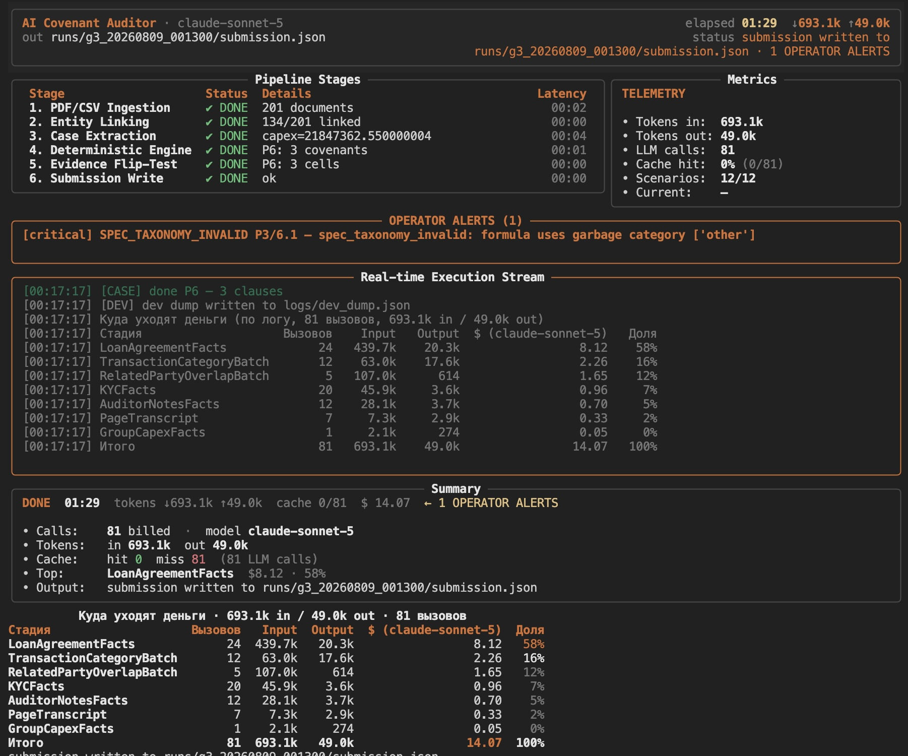
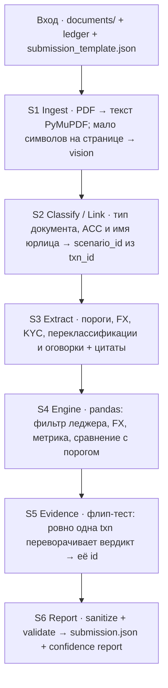
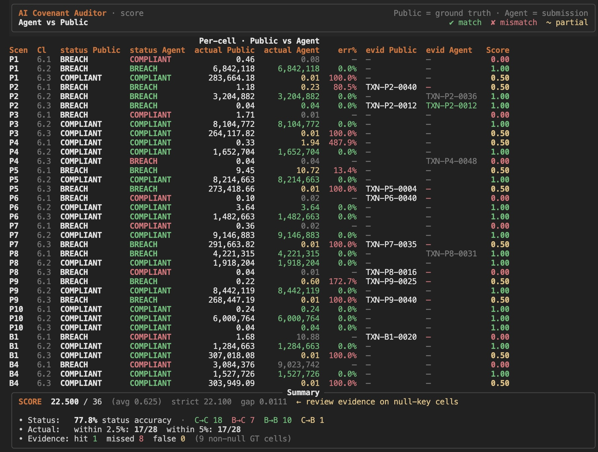

# Halyk AI Challenge — агент проверки ковенантов

Агент для участия в хакатоне
[Halyk AI Challenge](https://halykbank.kz/other/agentic-challenge#).
Решает задачу банковского аудита ковенантов: читает корпус кредитных PDF и
общий леджер транзакций и для каждой пары `(scenario_id, пункт ковенанта)`
заполняет ячейку `status` (`COMPLIANT` / `BREACH`), `actual` (фактическое
значение метрики) и `evidence_txn_id` (единственная транзакция, переворачивающая
вердикт, или `null`). Ключи ответа совпадают с `submission_template.json`.

<p></p>

## Запуск за две минуты

Нужны [uv](https://docs.astral.sh/uv/) и Python 3.12 (закреплён в `.python-version`).

```bash
git clone https://github.com/aviapoisk/halyk-ai-challenge.git
cd halyk-ai-challenge
uv sync --group dev
cp .env.example .env
```

В `.env` заполнить минимум: `ANTHROPIC_API_KEY` (или OpenAI-compatible ключ при
`AGENT_PROVIDER=openai`), `AGENT_MODEL`, `TEAM_NAME`, `CONTACT_EMAIL`. Полный
список переменных — в `.env.example` (`AGENT_PROVIDER`, `AGENT_EFFORT`,
`AGENT_ADAPTIVE_THINKING`, `AGENT_LLM_CONCURRENCY`, `AGENT_SELF_CONSISTENCY`,
`AGENT_BASE_URL` для локального endpoint).

```bash
R=results/submission1
uv run python -m agent.run \
  --dataset data/agentic-bank-hidden \
  --out $R/submission.json \
  --cache .cache/submission1 \
  --engine tree \
  --dev
```

Справка по флагам CLI:

```bash
uv run python -m agent.run --help
# то же: -h
```

| Флаг | Назначение |
|---|---|
| `--dataset <DIR>` | каталог с `master_ledger_*.csv`, `documents/`, `submission_template.json` |
| `--out <FILE.json>` | путь к `submission.json` |
| `--cache <DIR>` | sidecar-кэш parsed + LLM (по умолчанию `.cache`) |
| `--no-cache` | не читать и не писать кэш — живой вызов API |
| `--profile default\|fast\|careful` | пресет effort / concurrency |
| `--engine enum\|shadow\|tree` | движок ковенантов (default: `shadow`) |
| `--seed N` | reproducibility seed (any stochastic path) + confidence metadata |
| `--no-tui` | плоский лог без Rich Live (`AGENT_NO_TUI=1`) |
| `--only <scenario_id>` | один сценарий (dev) |
| `--dev` | писать `logs/dev_dump.json` для `tools/dev.py` |

Результат: `submission.json` по `--out`. Диагностика (`agent.log`, `trace.json`,
`confidence_report.json`, `config.json` с `git_sha` и ключами запуска) пишется в
`logs/` у корня репо, если `--out` — файл в CWD; иначе рядом с сабмитом в
`<out.parent>/logs/` (например `runs/<id>/logs/`). В `trace.json` те же ключи
лежат в поле `run`.

```bash
uv run python -m tools.validate \
  --submission submission.json \
  --dataset data/agentic-bank-public
# на боевом сете: --dataset <DIR> с private drop
```

## Архитектура



Модель извлекает смысл и цитаты из документов. Все числа в ответе считает Python:
фильтрация леджера, конвертация валют, переклассификации аудитора, агрегаты,
сравнение с порогом и флип-тест evidence. В `actual` / `status` / `evidence_txn_id`
не попадает ни одно значение, посчитанное моделью.

## Структура репозитория

```
agent/                      # S1–S6: ingest → link → extract → engine → evidence → report
tools/validate.py           # контракт submission.json без ground truth
tools/score.py              # скорер по формуле CASE (только открытый сет)
tools/dev.py                # read-only TUI разбора; не в боевом пути
tests/                      # юниты без LLM
data/agentic-bank-public/   # открытый датасет + CASE.ru.md / CASE.kz.md
.env.example                # ключи и TEAM_NAME / CONTACT_EMAIL / AGENT_MODEL
logs/                       # trace, confidence, dev_dump (локально)
.cache/                     # sidecar parsed + LLM (gitignore)
CLAUDE.md                   # инженерные правила пайплайна (для агентов/ревью)
```

## Решения и почему именно так

### Почему не нужен RAG

Корпус маленький и структурированный: ~200 PDF, суммарно ≈780k input-токенов,
медианный файл ~870 токенов — документ целиком влезает в контекст модели. Нужный
файл определяется не семантическим поиском, а детерминированной привязкой
(`ACC-\d{4}` + точное нормализованное имя юрлица → `scenario_id` из леджера).
Экстракция идёт per-document, дело заёмщика собирается в Python из JSON-фактов —
в промпт упирается размер одного документа, а не всего корпуса. Векторная база
решает задачу «найти релевантный фрагмент среди миллионов», которой здесь нет;
в трёхчасовом окне это лишняя точка отказа.

### Почему подсчёт в pandas, а не в LLM

Скоринг обнуляет `actual` при 5% относительной ошибки (для коэффициента 0.04 это
0.002 абсолютных) — «почти правильная» арифметика модели не даёт баллов. Принцип
пайплайна: LLM извлекает смысл и цитаты; Python принимает все решения и считает
все числа. Леджер целиком в модель не подаётся (~55–65k токенов и шум `ACC-9xxx`);
S4 на pandas фильтрует счёт и период, конвертирует FX по курсу из документов,
применяет переклассификации аудитора, считает метрику по дереву/семейству формул
и сравнивает с порогом с учётом carve-out. Тот же детерминированный пересчёт нужен
S5 (флип-тест evidence). В `status` / `actual` / `evidence_txn_id` не попадает
значение, посчитанное моделью.

### Как находятся ковенанты

1. **S2** классифицирует каждый PDF и привязывает к заёмщику; действующая редакция
   договора выбирается по датам периода в тексте (штамп «НЕДЕЙСТВУЮЩАЯ РЕДАКЦИЯ» —
   вторичный сигнал).
2. **S3** на договорах займа извлекает в `CovenantSpec` каждый пункт с числовым
   порогом/коэффициентом по метрике заёмщика или Группы — формула, порог,
   направление, период, валюта, оговорки, с обязательной дословной цитатой.
   Заголовок раздела («Финансовые ковенанты» и аналоги) — подсказка, не фильтр;
   номер пункта берётся как в тексте (`6.1`, …), без перенумерации.
3. Ключи ячеек — только из `submission_template.json`; извлечённые пункты
   сопоставляются с ними в Python (лишние отбрасываются, отсутствующие → stub +
   флаг). Шумовые политики и АХО пороги в дело не отдают.
4. **S4** исполняет спецификацию по леджеру; неизвестный тип уходит в
   generic/tree-fallback той же движковой арифметики, а не в вердикт LLM.

| Решение | Причина |
|---|---|
| `account_id → scenario_id` из префикса `txn_id` (`TXN-<scenario>-NNNN`) | В приватном сете счета и сценарии другие; хардкод ломает шаблон |
| Нормализация разрядки букв перед regex | Без неё теряется 12 из 66 якорей `ACC-\d{4}` (18%), в т.ч. аудиторские документы |
| Точное совпадение нормализованного имени юрлица, не fuzzy | В корпусе пары близких имён разных компаний (`Shymkent Refinery Services JSC` / `Shymkent Refinery JSC`) |
| Действующая редакция по датам периода в тексте; штамп «НЕДЕЙСТВУЮЩАЯ РЕДАКЦИЯ» — вторичный сигнал | Организатор-подтверждённое правило; штамп в приватном сете может отсутствовать или врать |
| Evidence через флип-тест движка, не правило «BREACH ⇒ evidence» | В открытом ключе 8 BREACH-ячеек имеют `evidence_txn_id = null` |
| Vision только если на странице мало символов | 199 из 200 PDF открытого сета с текстовым слоем; скан один |
| Экстракция per-document, сборка дела в Python | Контекст ограничен одним документом; кросс-документные формулы (Capex группы + EBITDA заёмщика) собирает код |
| Sidecar-кэш: `parsed/` по SHA файла, `llm/` по SHA(model + effort + prompt + content + schema) | Тёплый прогон воспроизводит ответы без API; `--no-cache` — живой вызов |
| Батч-категоризация спорных строк леджера (кэшируется), не per-row цикл | Иначе стоимость API растёт линейно с числом строк |
| Оговорки (carve-outs) проверяются цитатой против текста договора, затем применяются в движке | CASE допускает `actual` выше лимита при `COMPLIANT`; вердикт без оговорок ошибочен by design |
| Sanitize + атомарная запись `submission.json` даже при сбое сценария | Пустая ячейка = как неверная; файл без ответа хуже обоих |
| Один LLM-клиент-обёртка на весь код | Нет разрозненных SDK-вызовов; единый ключ кэша и схема Pydantic |

## Что найдено в данных

| Находка | Почему важно |
|---|---|
| `ACC-\d{4}` только в 66 из 200 документов | Один канал привязки недостаточен; нужен канал по имени компании |
| Letter-spacing в PDF ломает наивный regex (54 → 66 якорей после нормализации) | Пропуск аудита переворачивает `status` |
| 800 шумовых строк леджера на `ACC-9xxx` из 1473 | Считать только счета сценариев из шаблона |
| 28 строк EUR; курс — в документах заёмщика | Нет внешнего FX; нет курса → флаг, не угадывание |
| 12 договоров со штампом недействующей редакции 2024 | Неверный порог из старой редакции обнуляет ячейку |
| Capex группы в отчётности материнской компании, EBITDA — у заёмщика | Формула кросс-документная |
| Evidence непустой в 9 из 36 ячеек открытого ключа | В остальных 27 точность `actual` фактически стоит 0.50 |

## Воспроизводимость

Организаторы перезапускают решение своими ключами. Кэш ответов и парсинга —
локальный каталог `.cache/` (`parsed/` по хешу файла, `llm/` по хешу запроса).
Повторный прогон с тем же `--cache` и без `--no-cache` читает sidecar и не
дергает API на попадании.

Детерминизм тёплого прогона обеспечивается кэшем, а не сэмплированием модели:
у текущего Anthropic API параметр `temperature` для используемых вызовов не
задаётся (на новых моделях он отвергается); у OpenAI-compatible клиента
ставится `temperature=0`. Холодный прогон (`--no-cache` или пустой кэш) может
дать другой текст извлечения при том же промпте — числа в ответе по-прежнему
считает движок, но состав извлечённых фактов может отличаться.

Флаг `--no-cache` отключает чтение и запись sidecar. Каталог `data/cache/` под
закоммиченный reproducibility-кэш в `.gitignore` разрешён, но в репозитории не
поставляется: из свежего клона без API-ключа полный прогон не выполняется.

## Проверка ответа без ключа

```bash
uv run python -m tools.validate \
  --submission submission.json \
  --dataset <DIR>
```

Работает без `ground_truth.json` — это единственная проверка, доступная на
приватном сете. Проверяет: верхние ключи ровно `team` / `contact_email` /
`model` / `answers`; набор сценариев и пунктов совпадает с
`submission_template.json`; `status` ∈ {`COMPLIANT`,`BREACH`}; `actual` —
конечное число строго > 0 с ровно двумя знаками; `evidence_txn_id` — `null`
либо существующий `txn_id` того же сценария в леджере; `team` и
`contact_email` непустые. Код возврата 0 — ноль нарушений. Предупреждения
(например `COMPLIANT` с непустым evidence) не блокируют.

## Инструмент разбора (dev)

```bash
uv run python -m tools.dev --dataset data/agentic-bank-public
# или без нового прогона:
uv run python -m tools.dev --dataset data/agentic-bank-public --browse
```

На открытом сете — поклеточный разбор против ключа:

```bash
uv run python -m tools.score \
  --submission submission.json \
  --ground-truth data/agentic-bank-public/ground_truth.json
```

<p></p>

*Скорер: per-cell Public vs Agent (status / actual / evidence), err%, итог и status accuracy.*

`tools/dev.py` — read-only браузер `logs/dev_dump.json`: обзор дела, документы,
ковенанты, транзакции. Из `agent.run` не импортируется. Ручное редактирование
ответов невозможно и запрещено правилами хакатона (дисквалификация).
`tools/score.py` на приватном сете не запускается — там нет `ground_truth.json`.

## Тесты

```bash
uv run pytest -q
```

263 теста в `tests/` (`pytest --collect-only`), без живых вызовов LLM.

Гарантии: формула скорера и правило evidence-null (`tools/score.py`); контракт
валидатора; нормализация разрядки / имён / якорей `ACC`; флип-тест evidence на
игрушечном леджере; арифметика S4 (FX, переклассификации, семейства формул);
атомарная запись и sanitize S6; восстановление при падении сценария с записью
полного `submission.json`; discovery датасета по структуре каталога.
